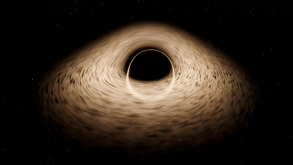
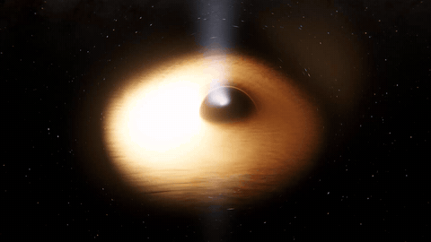
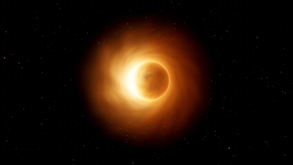

# Black Hole Renderer

A real-time, ray-marched black hole for Unity URP. Gravitational lensing of your skybox, and a spinning accretion disk with blackbody color, a physically based temperature profile, and relativistic Doppler and gravitational redshift.

<table>
  <tr>
    <td></td>
    <td></td>
    <td></td>
  </tr>
  <tr>
    <td align="center">Interstellar</td>
    <td align="center">M87</td>
    <td align="center">Sgr A</td>
  </tr>
</table>

## Installation

Requires **Unity 6** with **URP** (RenderGraph).

In Unity, open **Window → Package Manager**, click **+ → Install package from git URL…**, and enter:

```
https://github.com/cannoli-cat/black-hole-renderer.git#v2.7.0
```

## Setup

1. Add **Black Hole Feature** to your URP renderer (Renderer asset → **Add Renderer Feature**), and assign the `BlackHole` shader and `BlackHole` compute shader from this package.
2. Add the **Black Hole** component to a GameObject. Its position is the black hole's position.
3. Use a **cubemap skybox** material in Lighting settings. It's what gets lensed. Without one, the background renders black.

Tune the radius, spin, disk size, temperature, disk exposure and sky intensity on the renderer feature.

## Presets

The renderer feature has a **Preset** field. Assign one and click **Apply** to copy its values into the settings, or click **Save Current to Preset** to store yours. The package includes:

- **Realistic**: a physically based thin disk around a fast-spinning black hole.
- **Quasar**: a hotter, brighter, more turbulent disk.
- **M87**: a thick, dim, orange disk, like the Event Horizon Telescope image.
- **Interstellar**: a Gargantua-style disk with no Doppler shift, long hair-like streaks and a frayed outer edge.
- **Flare**: the Realistic disk with an orbiting hot spot, to show its delayed echoes.
- **M87 EHT**: M87* as astronomers model it: no thin disk, just a hot, see-through, turbulent flow that glows into a bright ring at the photon orbit, plus a faint jet. Look at it from about 17° off the spin axis for the Event Horizon Telescope view.
- **Sgr A**: Sgr A*, the black hole at the center of the Milky Way: a thicker, faster-flickering hot flow and no jet. The Event Horizon Telescope image suggests we see it from within about 30° of its spin axis.

Create your own with **Create → CannoliCat → Black Hole Preset**.

## Ray tracing

**Exact** (the default) traces true Kerr light paths around a spinning black hole. **Fast** uses Schwarzschild bending with approximate frame dragging. It's cheaper, so use it on WebGL and mobile.

## Observer

**Observer Motion** sets how the camera moves:

- **Manual**: uses **Observer Velocity**, a world-space velocity as a fraction of the speed of light. Zero means at rest relative to the black hole.
- **Orbiting**: a circular orbit at the camera's current distance, moving with the disk.
- **Falling**: falling straight in from rest far away.

Moving fast bends the view toward the direction of motion and shifts colors blue ahead and red behind. Close to the hole, light falling down to the camera is also shifted bluer and brighter. In Exact mode the camera can also go inside the horizon: there it's always a freely falling observer, since nothing can stay at rest. Fast mode needs the camera to stay outside.

To fly a real orbit, add **Black Hole Orbit Camera** to your camera. It moves the camera around the hole at the correct orbital speed, on the same clock as the disk, so the gas beside you keeps pace with you. While it's active, that camera always renders as Orbiting. Raise the disk's **Evolution Speed** or the component's **Speed Multiplier** for a faster orbit.

To fall in, add **Black Hole Fall Camera** instead. It drops the camera from where you placed it, at the correct speed, through the horizon, and stops just short of the center, optionally looping. While it's active, that camera renders as Falling with Exact ray tracing. Set **Look** to **Away** inside the horizon to see the outside universe shrink into a bright patch behind you.

## Hot spot

Raise **Hot Spot Strength** to add a bright blob orbiting in the disk. Light from it reaches the camera along several paths that take different amounts of time, so you see it directly and then again as delayed echoes in the lensed image above the hole and in the photon ring. **Hot Spot Radius** sets its orbit (as a multiple of the innermost stable orbit) and **Hot Spot Size** its size.

## Jets

Raise **Jet Brightness** to add relativistic jets along the spin axis, like M87's. **Jet Speed** sets how close to the speed of light the material moves: faster jets look more one-sided, because the jet coming toward you is boosted and the other is dimmed. **Jet Knots** breaks the jet into bright blobs that travel outward; seen from close to the jet's axis they can appear to move faster than light. The jets are lensed by the black hole like everything else.

## Hot flow

Raise **Hot Flow Brightness** to add a hot, puffy, see-through flow around the hole, the kind M87* and Sagittarius A* really have. It glows all around the hole, and the light that skims the photon orbit piles up into a bright, thin ring, brighter on the side where the gas comes toward you. Set **Disk Density** to 0 for the pure Event Horizon Telescope look, or keep the disk for a disk with a hot corona.

- **Thickness**: low values hug the disk plane and leave a deep dark center; high values make the flow nearly round and fill the shadow with glowing gas in front of it.
- **Falloff**: how fast the glow fades with distance. Higher values concentrate the light near the ring.
- **Opacity**: how much the flow absorbs light passing through it.
- **Turbulence**: clumps that orbit with the gas, shear into spirals and slowly change, so the ring flickers.
- **Temperature**: colors the flow like the disk, hottest near the hole, whiter where gas moves toward you and redder where it moves away. At 0 the flow uses **Color** instead. The real light is radio waves, so this shows how the flow would look if it glowed in visible light.

For the view in the Event Horizon Telescope image of M87*, use the **M87 EHT** preset and place the camera about 17° from the spin axis (the black hole's local Y axis), looking at the hole. Roll the camera so the bright side is at the bottom.

## Disk look

Everything is physically based by default. **Doppler Strength** and **Temperature Falloff** at 1 are physical. Lower them for an *Interstellar*-style disk.

The turbulence settings shape the gas:

- **Turbulence Contrast**: how much the turbulence heats and cools the gas.
- **Filament Sharpness**: soft clouds at 0, sharp filaments at 1.
- **Turbulence Warp**: swirls the gas into eddies.
- **Orbital Stretch**: stretches the gas into streaks along the orbit.
- **Edge Fraying**: breaks the outer disk into separate wispy strands.
- **Plunging Gas** and **Plunge Glow**: gas spiralling in from the disk's inner edge to the horizon.

If it runs too slowly, lower **Render Scale** on the renderer feature. It renders the black hole and sky at a fraction of the screen resolution and upscales them, while scene objects stay sharp. 0.75 is about 1.8x cheaper, 0.5 about 4x.

For the best result, turn on **HDR** in your URP asset and use a tonemapper (Neutral or ACES). The disk is much brighter than 1, and without HDR the bright side gets clipped to flat white.

## License and attribution

**CC BY 4.0.** You may use, modify and redistribute this, including in commercial games, **as long as you give credit.**
In your game's credits (or documentation / about screen), include:

> Black Hole Renderer by Tyler Wolfe (cannoli-cat) — https://github.com/cannoli-cat/black-hole-renderer

See [LICENSE.md](LICENSE.md) for the full license text.
